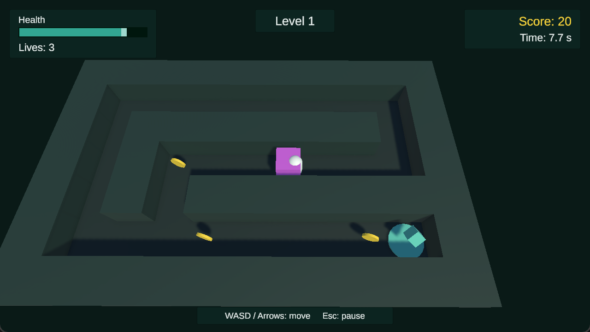
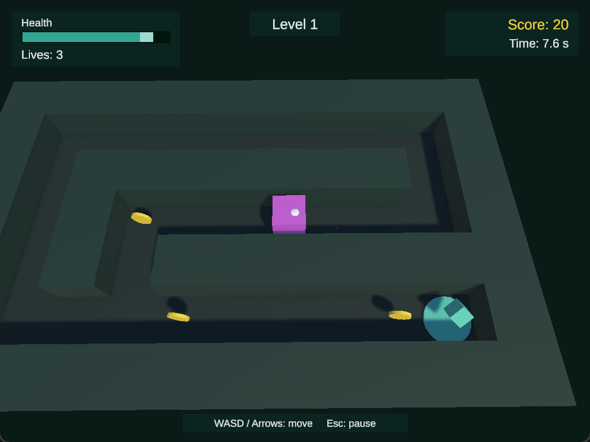
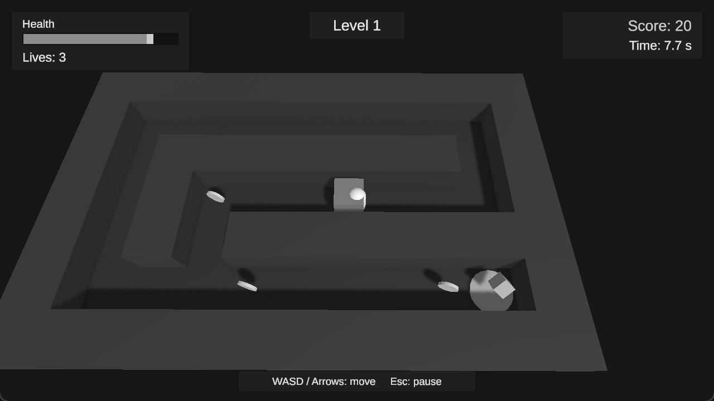

# CS464 Assignment 04 · Fasiha Rohail · BSSE23041

**Video Link** :https://youtu.be/n2XFxx1Kh6s

**Coin Maze** is a simple 3D maze game made only with Unity's basic shapes. You move the white capsule with WASD or the arrow keys, pick up the gold coins, dodge the purple blocks and reach the teal exit. Esc pauses the game. I started this from a new Unity 6.3 project (not my Assignment 03 repo) and made the seven scenes this assignment needs.

## Settings

| Part | Setting | Value | Why |
|---|---|---|---|
| A | Harmony · base hue | triadic · 170° | Teal (170°) is the base. Its triadic partners are gold (50°) and violet (290°), so I used them as the two accents: gold for good things and violet for danger. |
| A | Dark · mid · light | #0E2521 · #30A692 · #EAF5F3 | Dark is used for every panel, mid for the buttons and the health fill, and light for the text and the player. Their brightness is very different, so they still look different in grayscale. |
| A | Accents | #F5D63D · #C85FDD | Gold is used for coins and the score, and violet for the hazards. In grayscale the gold looks light and the violet looks mid grey, so a coin never looks like a hazard. |
| A | HUD text (#EAF5F3) on its panel (#0E2521) | 14.44 : 1 | All HUD text sits on a solid dark panel, not straight over the level. The gold score text on the same panel is 11.16 : 1. I measured both with `ColourUtil.Contrast`. |
| A | Button label (#0E2521) on the button (#30A692) | 5.36 : 1 | White on the teal button was only 3.00 : 1, so I switched to a dark label. A selected button turns gold, and the dark label on gold is 11.16 : 1. |
| B | Music · SFX groups, as mixed | 0 dB · 0 dB | I made the music track quiet when I generated it (and set its AudioSource to 0.8), so both groups can stay at 0 dB. The slider then turns the music down from there. |
| B | Slider at 1 · 0.5 · 0.0001 | 0 dB · −6 dB · −80 dB | `Mathf.Log10(value) * 20`, so the slider feels even to the ear. The minimum is 0.0001 and not 0, because Log10(0) is minus infinity. |
| C | Hazard hum (the first purple block), in Level 1 (and every level) | Linear · Min 1 m · Max 8 m | It is a warning sound, so it should only be heard near the block. Linear goes fully silent at 8 m (about 4 maze cells), and Min 1 m is about the size of the block. |
| C | Goal chime (the exit pad), in Level 1 (and every level) | Logarithmic · Min 2 m · Max 30 m | You should be able to hear the exit from far away and follow it as it gets louder. Min 2 m is the size of the pad, and Max 30 m is about the size of the biggest maze. |
| C | AudioListener | On the player, on an empty object with `ListenerOnPlayer.cs` | The camera follows from about 15 m above and behind, so a listener on the camera would hear everything from far away. I removed the camera's listener and the empty object follows the player instead. In the menu and credits the listener stays on the camera (they have no 3D sounds). |
| D | unlocked | int · default 1 | When the game is brand new only Level 1 is open. |
| D | best1 … best5 | float · HasKey first | A level only shows a best time if one was really saved. |
| D | MusicVolume | float · default 1 | Full volume the first time the game runs. |

## Answers

1. **What `Time.timeScale = 0` stops in my game, and what it doesn't:** It stops the Rigidbody physics (FixedUpdate stops running), the bobbing and spinning hazards, the spinning coins, the level timer (`Time.timeSinceLevelLoad`) and the health bar's lag slide, because they all use scaled time. It does not stop `Update`, so the player script starts with `if (PauseMenu.IsPaused) return;`, and Esc is still read. The UI still works. Sound isn't stopped either, so I also set `AudioListener.pause`.

2. **What survives a LoadScene in my game, and how:** The MusicPlayer and the SfxPlayer survive because they call `DontDestroyOnLoad`. Every scene has a copy so it can be tested alone, but the singleton check in Awake makes the new copy destroy itself, so there is never a second one. Static things also survive: `PauseMenu.IsPaused`, `Time.timeScale` and `AudioListener.pause`. That's why `Resume()` runs before every load and the LevelLoader sets the time scale back to 1. The PlayerPrefs are on disk.

3. **Why every PlayerPrefs read in my game has a default:** The first time the game runs, none of the keys exist. Without the default of 1, `unlocked` would read 0 and every level would be locked, even Level 1. MusicVolume would read 0, and `Log10(0)` is minus infinity dB, so the music would be silent. For best times I check `HasKey` first, because a default of 0 would look like a perfect 0.0 s time that nobody could ever beat.

4. **An exception a forgotten unsubscribe would throw, and why mine can't:** If the HealthBar did `+=` on `health.Damaged` but never `-=`, a destroyed bar could stay on the event list. The next hit would then call `OnHealthChanged` on a dead component, and touching its Image would throw a `MissingReferenceException`. In my game every listener (HealthBar, HitFeedback, CameraFollow and LevelManager) subscribes in OnEnable and unsubscribes in OnDisable. OnDisable always runs when an object is turned off, destroyed or unloaded with its scene.

## Credits

I didn't use any sound or music made by someone else. I made all of them myself with my own script, `Assets/Editor/SoundMaker.cs`.

- Background music (music.wav) · me · made with Assets/Editor/SoundMaker.cs · my own work
- Sound effects (pickup, hit, click, win, lose, hazard hum, goal chime) · me · made with Assets/Editor/SoundMaker.cs · my own work
